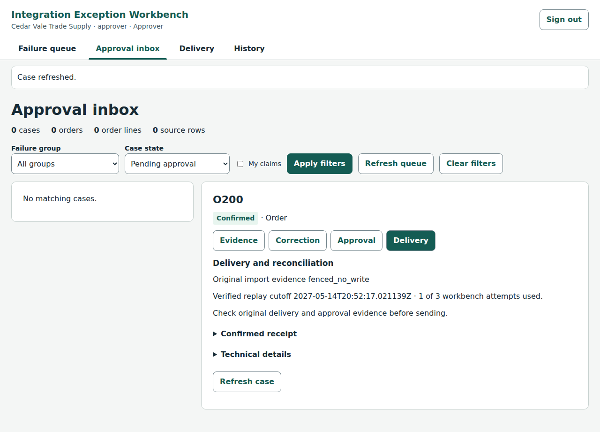

# Customer and Order Recovery Workbench

**Approval-gated repair and replay of failed imports**

Review failed customer and order imports before sending them again. The workbench gives analysts the original source records and lets a separate approver review the proposed correction. It sends the approved records to a local simulator and checks the receipt against the write it finds there.

The application identifies itself as **Integration Exception Workbench (IEW-FRESH)**. This source snapshot contains version 0.1.0 for the local simulator milestone.

[Run the demo](docs/QUICKSTART.md) · [Read the design](docs/ARCHITECTURE.md) · [See the test results](docs/VERIFICATION.md)

## Example

The demo creates a fictional customer, C100, and an order, O200. Line 1 of the order uses an unknown item alias. The analyst replaces it with `ITEM-1` and submits the exact order preview. The approver checks the preview, approves it, and checks the original delivery evidence before sending the order.

The case reaches **Confirmed** when the receipt and the simulator's stored record match the approved payload. Approval and Send are separate actions.

The screenshot comes from a Chromium test of the running local application.

## Run locally

Use Python 3.12, Node.js with npm, and PostgreSQL 16 with its client tools. The [setup and demo guide](docs/QUICKSTART.md) shows the commands, the database roles, and the two local services. It also shows how to run the included tests.

## How it works

- Intake checks the CSV file against its error manifest. The workbench keeps the original bytes and records the reason for each correction.
- A TypeScript browser calls a Python service. A delivery worker sends approved work to a separate HTTP simulator.
- Three PostgreSQL databases hold workbench state, simulator state, and the delivery attempt journal. The worker uses the journal to recover after a crash.
- The workbench offers local repair and audit exports. It holds delivery when it cannot verify what the destination wrote.

Read the [architecture and operating scope](docs/ARCHITECTURE.md) for the transaction, recovery, and advisory design.

## What the tests show

The exact v0.1.0 candidate passed the local engineering review. The independent reviewer exercised 1,064 regression cases and issued a pass after the corrected database-client recovery retest passed all 22 runs. The [verification summary](docs/VERIFICATION.md) records the test scope, environments, and reproduction commands.

## Data and operating scope

The demo generates fictional records from the included Python source. The normal local workflow uses deterministic validation rules with inference disabled. Offline fixtures exercise the inference controls. Live model quality, human workflow outcomes, and production deployment require separate qualification.

## License and reuse

The project owner has yet to declare a source license. Ask the owner for permission to reuse or redistribute the source. The dependency manifests identify the third-party packages.
